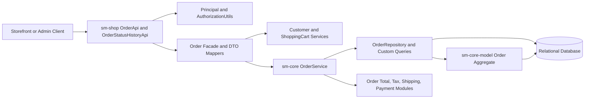
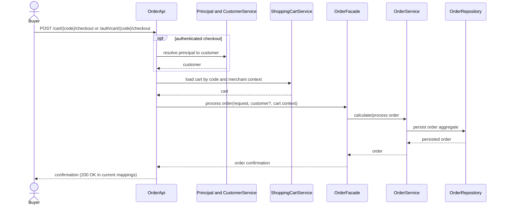
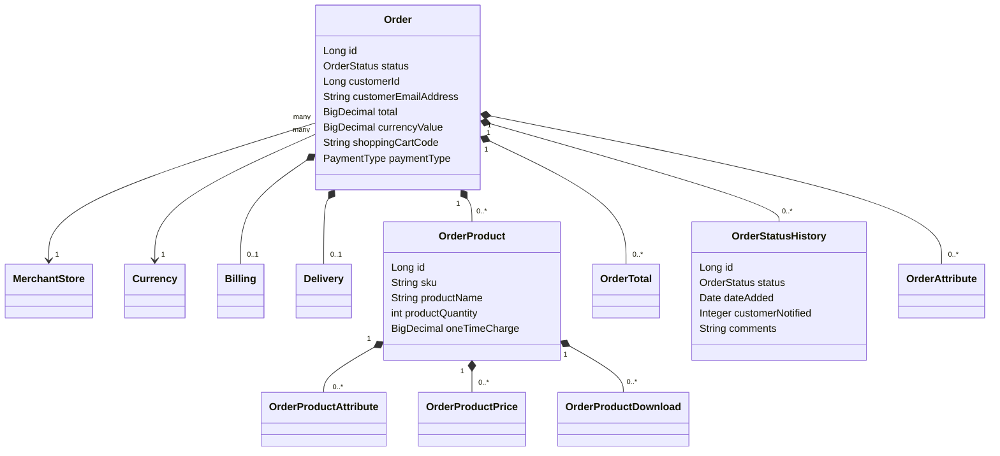

# Order Management Design

## Plan: Baseline and Technical Constraints

Keep Shopizer's existing layered implementation: `sm-shop` owns REST adapters and authorization; facade/populator code maps API DTOs to the `sm-core-model` aggregate; `sm-core` owns order business operations and persistence contracts. Checkout delegates to `OrderFacade`, which coordinates customer/cart and order services rather than constructing persistence rows in the controller.

The `Order` aggregate is merchant-scoped and cascades line items, totals, history, and attributes. `OrderService` exposes lookup/list, save/update, checkout processing, total calculation, invoice generation, downloadable-item detection, and capturable-order queries. `OrderRepository` provides the JPA lookup plus custom listing queries.

## Request Design

- Keep authenticated and anonymous checkout DTOs separate; never accept a customer identity from an authenticated request body as the authority.
- Resolve merchant and locale/language from established request context.
- Enforce the authenticated principal/merchant/role scope before returning or mutating order data.
- Persist status and status-history changes through the service/facade boundary.
- Reuse the established total-calculation pipeline rather than recomputing amounts in a controller.

## Hardening Decisions

1. Define the legal status-transition graph and reject invalid transitions.
2. Define checkout idempotency and payment/inventory compensation.
3. Audit response DTOs and logs for payment data and customer PII.
4. Confirm status/history atomicity, event/notification behavior, and authorization coverage for customer routes.
5. Confirm API pagination conventions; the source contains `start`/`count` and `page`/`count` variants.

No new production implementation is introduced by this analysis pack. Proposed design improvements remain decisions, not baseline guarantees.

### Implementation constraints

- Upstream parent POM targets Java 11 and Spring Boot 2.5.12; source is pinned to tag `3.2.7` even though POM artifact versions report `3.2.5`.
- Keep persistence in `sm-core-model` / `sm-core`, API adapters in `sm-shop`, and use the existing facade/service/repository boundary.
- Preserve API v1 paths and DTO contracts when documenting the baseline; no endpoint migration is part of this scope.
- Validation must run against the upstream Maven reactor. The SpecLoop artifact folder is not itself a Maven project, so its test specifications are not independently executable.
- Treat the generated-code folder as a source-derived snapshot, not deployable generated output; in particular, the normalized controller class must not be added alongside upstream `OrderApi` because it would register duplicate mappings.

## Architecture

The diagram represents observed module boundaries. Payment, shipping, and tax are collaborators; their transaction or failure semantics are not asserted here.

## Checkout Sequence

The diagram captures the API-to-domain flow. Payment authorization, stock updates, rollback, and notification steps are omitted because their ordering and guarantees were not established by the inspected controller and service contract.

## Data Model

`customerId` is deliberately scalar in the inspected entity. The relationship from `Order` to `MerchantStore` and `Currency` is many-to-one; the embedded values and cascaded child records follow the JPA mappings.