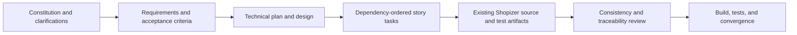

# Implementation Tasks
Tasks are dependency-ordered and mapped to user stories. `[x]` means completed in this SpecLoop analysis/verification cycle; it does not mean every proposed hardening criterion is satisfied. Unchecked tasks are explicit convergence follow-ups.

## Phase 1: Setup and Foundation

- [x] T001 Pin upstream Shopizer tag, commit, and POM/runtime versions. (Constitution 1, REQ-01)
- [x] T002 Map order ownership across model, core service/repository, and REST API modules. (REQ-01, REQ-02)
- [x] T003 Extract source snapshots and preserve upstream license/provenance. (REQ-01 to REQ-10)
- [x] T004 Record scope clarifications, unresolved business policies, and external collaborators. (C-01 to C-06)

## Phase 2: User Stories

### US-01: Checkout and confirmation

- [x] T005 Document authenticated and anonymous cart-checkout entry points and their separate request contracts. (REQ-03, REQ-04; AC-01, AC-02)
- [x] T006 Trace checkout from API through facade/service to persistence and confirmation DTO. (REQ-01 to REQ-04)

### US-02: Customer order history

- [x] T007 Document authenticated customer listing and detail endpoints, principal resolution, pagination, and merchant context. (REQ-05; AC-03)

### US-03: Merchant staff operations

- [x] T008 Document private order listing, supported filters, merchant-scoped detail lookup, customer update, and role gates. (REQ-06 to REQ-08; AC-04 to AC-06)
- [x] T009 Document recognized status values and status-history API; leave transition policy unresolved. (REQ-09, REQ-10; AC-07, AC-08)

### US-04: Durable order records

- [x] T010 Map order aggregate, child records, merchant/currency ownership, and customer snapshot semantics. (REQ-01, REQ-02, REQ-11, REQ-12; AC-09, AC-10)

## Phase 3: Polish and Verification

- [x] T011 Create JUnit, Cucumber, and API test specifications and map each requirement to evidence or a named gap. (AC-01 to AC-12)
- [x] T012 Run the focused order test and broad upstream Maven reactor on the available JDK; record exact command/results and failures. (NFR-01 to NFR-05)
- [x] T013 Run cross-artifact consistency review and repair stale paths before convergence. (All requirements)
- [ ] T014 Close deferred security/business-policy decisions and add enabled tests for gaps before claiming production hardening complete. (AC-07 to AC-12, NFR-01, NFR-04, NFR-05)

## Traceability Flow

